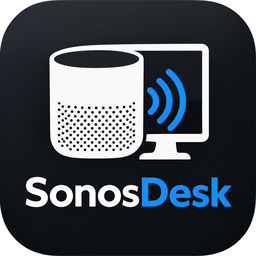

<p align="center">
  
</p>

<h1 align="center">SonosDesk</h1>

<p align="center">
  <b>Sonos-Lautsprecher direkt vom Windows-Desktop steuern – gleich neben der Uhr.</b><br/>
  Open Source · lokale Steuerung ohne Cloud-Konto · keine Telemetrie
</p>

<p align="center">
  <a href="https://github.com/adriankrypton/sonosdesk/releases/latest"></a>
  <a href="https://github.com/adriankrypton/sonosdesk/actions/workflows/ci.yml"></a>
  
  
  <a href="LICENSE"></a>
</p>

<p align="center">
  <a href="README.md">English</a> · <b>Deutsch</b>
</p>

---

SonosDesk findet deine Sonos-Lautsprecher automatisch. Du kannst abspielen, pausieren, Titel
wechseln, die Lautstärke ändern, Räume gruppieren und Radiosender starten – in einem modernen
Fenster im Windows-11-Stil **oder direkt über das Symbol im Infobereich**, ohne zum Handy zu greifen.

> SonosDesk ist ein unabhängiges Community-Projekt und steht in keiner Verbindung zu Sonos, Inc.
> „Sonos“ ist eine Marke der Sonos, Inc.

## Inhalt

- [Versionshinweise](#versionshinweise)
- [Funktionen](#funktionen)
- [Download und Installation](#download-und-installation)
- [Erster Start](#erster-start)
- [Bedienung im Alltag](#bedienung-im-alltag)
- [Tastenkürzel](#tastenkürzel)
- [Probleme lösen](#probleme-lösen)
- [Datenschutz und Netzwerk](#datenschutz-und-netzwerk)
- [Unterstützte Lautsprecher und Einschränkungen](#unterstützte-lautsprecher-und-einschränkungen)
- [Für Entwickler](#für-entwickler)
- [Lizenz](#lizenz)

## Versionshinweise

### 0.1.0 – 18. Oktober 2026 · erste öffentliche Version

- Installer für Windows 10/11 (pro Benutzer, ohne Administratorrechte) und eine portable Einzeldatei
- Automatische Lautsprechersuche, manuelle IP-Adressen für VPN, Gast-WLAN und VLANs
- Wiedergabe mit Spulen, Zufall, Wiederholen und Überblenden – auch bei **Spotify Connect**
- Lautstärke pro Raum und Gruppe; **Lautstärkeprofile blenden sanft über** statt zu springen
- Gruppen, Gruppen-Assistent, farbige Bereiche, Party-Modus, Mehrfachauswahl mit Strg
- Warteschlange, Schlaf-Timer, Klang pro Raum (Bässe, Höhen, Loudness, Nachtmodus, Sprachverbesserung)
- **Lautsprecher-Info** per Rechtsklick: IP-Adresse, Hostname, Modell, Software-/Hardware-Version, MAC, Seriennummer
- Internetradio (Radio Browser) mit *Meine Sender*, Ordnern, eigenen Logos und eigenen Stream-URLs
- Tray-Flyout und -Menü, Medientasten, Windows-Medienanzeige, Tastenkürzel, Schnellaktionen, Zeitpläne, 8 Sprachen
- Update-Hinweis, sobald eine neue Version veröffentlicht ist

Alle Versionen im Detail: [CHANGELOG.md](CHANGELOG.md) (englisch) · Downloads: [Releases](https://github.com/adriankrypton/sonosdesk/releases)

## Funktionen

**Steuerung im Alltag**
- Abspielen/Pause, vor/zurück, im Titel spulen, Zufall, Wiederholen, Überblenden
- Titel, Interpret, Album und Cover – auch für Musik, die in der Spotify-App per **Spotify Connect** gestartet wurde
- Lautstärke pro Raum und für ganze Gruppen, Stummschalten
- **Lautstärkeprofile** wie „Abend“ oder „Party“ – die Lautstärke blendet über eine einstellbare Zeit über
- **Warteschlange:** sehen, was als Nächstes kommt, ab einem Titel abspielen, Titel entfernen, leeren
- **Schlaf-Timer** von 15 bis 120 Minuten mit Countdown
- **Klang pro Raum:** Bässe, Höhen, Loudness – bei Soundbars zusätzlich Nachtmodus und Sprachverbesserung
- **Lautsprecher-Info:** Rechtsklick auf einen Lautsprecher zeigt IP-Adresse, Hostname, Modell, Versionen, MAC und Seriennummer

**Räume und Gruppen**
- Räume mit einem Klick gruppieren und trennen, **Party-Modus** (alle Räume spielen dasselbe)
- **Gruppe erstellen:** Lautsprecher, Favorit und Lautstärke wählen – fertig
- **Bereiche:** benannte, farbige Raum-Kombinationen wie „Erdgeschoss“, mit einem Klick gruppiert
- Klick auf eine Gruppe spielt in der ganzen Gruppe, Klick auf einen einzelnen Lautsprecher nur dort, mit Strg+Klick wählst du mehrere Räume

**Musik**
- Deine **Sonos-Favoriten** („Mein Sonos“)
- **Internetradio** mit Tausenden Sendern aus dem offenen Verzeichnis [Radio Browser](https://www.radio-browser.info):
  Suche, Genres, Länder, *Meine Sender* mit Ordnern, eigenen Logos und eigenen Stream-URLs
- Beim Radio zeigt SonosDesk den **Song, der gerade läuft**, statt kryptischer Stream-Namen
- Gestartete Sender erscheinen in der offiziellen Sonos-App als „Sender · via SonosDesk“

**Windows-Integration**
- **Symbol im Infobereich:** Linksklick öffnet ein kompaktes Flyout, Rechtsklick ein vollständiges Menü –
  SonosDesk läuft weiter, wenn das Fenster geschlossen ist
- **Medientasten** und die Windows-Medienanzeige (neben der Lautstärkeanzeige) steuern den aktiven Raum
- Globale Tastenkürzel, Schnellaktionen, Zeitpläne (z. B. „werktags 7:00 – Radio in der Küche“)
- Helles/dunkles Design, Start mit Windows, Karten der Startseite per Drag & Drop anordnen
- **8 Sprachen:** Deutsch, English, Français, Español, Italiano, Nederlands, Polski, Русский
- **Update-Hinweis**, sobald eine neue Version auf GitHub veröffentlicht ist

Die ausführliche Funktionsübersicht (inkl. was auf echter Hardware geprüft wurde) steht in
[docs/features.md](docs/features.md) (englisch).

## Download und Installation

Öffne die [neueste Version](https://github.com/adriankrypton/sonosdesk/releases/latest) und wähle:

| Datei | Wofür |
| --- | --- |
| `SonosDesk-Setup-X.Y.Z-win-x64.exe` | **Empfohlen.** Installiert SonosDesk für dein Benutzerkonto (ohne Administratorrechte), legt einen Startmenü-Eintrag an, optional ein Desktop-Symbol und „Mit Windows starten“. |
| `SonosDesk-X.Y.Z-win-x64-portable.exe` | Portable Einzeldatei – aus einem beliebigen Ordner starten, es wird nichts installiert. |
| `SHA256SUMS.txt` | Prüfsummen zum Kontrollieren der Downloads (`Get-FileHash <Datei>` in PowerShell). |

Voraussetzungen: Windows 10 (ab Version 2004) oder Windows 11, 64 Bit, und Sonos-Lautsprecher im
selben Heimnetz (S1- oder S2-System). Eine separate .NET-Laufzeit ist nicht nötig.

> **Windows SmartScreen:** SonosDesk ist noch nicht digital signiert. Windows zeigt daher eventuell
> „Der Computer wurde durch Windows geschützt“. Klicke auf **Weitere Informationen → Trotzdem ausführen**.

**Updates:** SonosDesk prüft beim Start, ob es eine neuere Version gibt, und zeigt dann einen Hinweis
mit *Herunterladen*, *Später* und *Diese Version überspringen*. Starte das neue Setup – es aktualisiert die
vorhandene Installation, deine Einstellungen bleiben erhalten. Die Prüfung lässt sich unter
*Einstellungen → Updates* abschalten.

**Deinstallieren:** *Windows-Einstellungen → Apps → Installierte Apps → SonosDesk → Deinstallieren*. Dabei
wirst du gefragt, ob auch deine Einstellungen (`%LOCALAPPDATA%\SonosDesk`) gelöscht werden sollen. Bei der
portablen Version schaltest du in den Einstellungen *Mit Windows starten* aus, beendest SonosDesk und
löschst die Datei.

## Erster Start

1. Starte SonosDesk. Wenn Windows nach der Firewall fragt, erlaube den Zugriff in **privaten Netzwerken**.
2. Nach wenigen Sekunden erscheinen deine Räume links. Beim nächsten Start ist der zuletzt genutzte Raum ausgewählt.
3. Nichts gefunden? Rechtsklick in die leere Raumliste → **Lautsprecher per IP-Adresse hinzufügen …** und die
   IP eines beliebigen Lautsprechers eingeben (Sonos-App → *Einstellungen → System → Über mein System*). Ein
   Lautsprecher reicht, die anderen Räume werden darüber gefunden.

Die Sprache richtet sich nach Windows und lässt sich unter *Einstellungen* ändern.

## Bedienung im Alltag

| Wo | Was du tun kannst |
| --- | --- |
| Raumliste (links) | Raum oder Gruppe anklicken, um sie zu steuern · einzelnen Lautsprecher einer Gruppe anklicken, um nur dort zu spielen · mit **Strg+Klick** mehrere Räume wählen und dann einen Favoriten oder Sender starten – genau diese Räume werden gruppiert · **Rechtsklick → Info** zeigt die Lautsprecher-Details |
| Startseite | Aktuelle Wiedergabe mit Spulen, Überblenden und Schlaf-Timer · Favoriten · Raumlautstärken · Warteschlange · Klang · Gruppieren. Karten über den ☰-Griff verschieben |
| *Radio* | Sender suchen und stöbern, ☆ speichert sie unter *Meine Sender*; Rechtsklick für Ordner und Logos; *Eigener Sender* fügt eine eigene Stream-URL hinzu |
| *Gruppe erstellen* | Lautsprecher wählen, optional Favorit oder Sender und Lautstärke, auf Wunsch als Schnellaktion speichern |
| *Bereiche* | **+** legt eine benannte, farbige Raum-Kombination an; ein Klick gruppiert diese Räume |
| Symbol im Infobereich | Linksklick: Flyout · Rechtsklick: Räume, Favoriten, Sender, Bereiche, Lautstärkeprofile, Party-Modus, Schlaf-Timer, Schnellaktionen, Beenden · Doppelklick: Hauptfenster |
| *Einstellungen* | Design, Sprache, Start mit Windows, Medientasten, Gerätesuche, Lautstärkeschritt und **Überblendzeit der Lautstärkeprofile**, Profile, Schnellaktionen, Zeitpläne, Tastenkürzel, Updates |

Das Schließen des Hauptfensters lässt SonosDesk im Infobereich weiterlaufen (in den Einstellungen änderbar).
Ganz beenden kannst du es mit **Beenden** im Tray-Menü.

## Tastenkürzel

| Wo | Kürzel |
| --- | --- |
| Überall (anpassbar) | `Strg+Alt+P` Abspielen/Pause · `Strg+Alt+←/→` zurück/vor · `Strg+Alt+↑/↓` Lautstärke |
| Medientasten | Abspielen/Pause, vor, zurück im aktiven Raum (abschaltbar) |
| Hauptfenster | `F5` neu suchen · `Strg+Leertaste` Abspielen/Pause · `Strg+←/→` Titel · `Strg+↑/↓` Lautstärke · `Strg+M` stumm · `Strg+,` Einstellungen |

## Probleme lösen

**Es werden keine Lautsprecher gefunden**
- PC und Lautsprecher müssen im selben Netz sein – Gast-WLAN, VPN und getrennte VLANs blockieren die Suche oft.
- SonosDesk in der Windows-Firewall für private Netzwerke erlauben (UDP 1900 und TCP 1400 im lokalen Netz).
- Lautsprecher per IP-Adresse hinzufügen (Rechtsklick in die Raumliste oder *Einstellungen → Netzwerk & Gerätesuche*).
- Weitere Hilfe: [docs/discovery.md](docs/discovery.md) (englisch).

**Die Medientasten steuern die falsche App** – Windows schickt sie an die zuletzt aktive Medien-App.
Schalte in den Einstellungen *Windows-Medientasten und Medienanzeige verwenden* aus, wenn du sie lieber
für andere Apps nutzt.

**Ein Befehl schlägt fehl** – SonosDesk zeigt den Fehler oben im Fenster an. Protokolle für Fehlerberichte
findest du unter *Einstellungen → Über SonosDesk → Protokolle öffnen* (`%LOCALAPPDATA%\SonosDesk\logs`).
Sie enthalten keine Passwörter oder Tokens.

**Fehler gefunden oder eine Idee?** Eröffne ein [Issue](https://github.com/adriankrypton/sonosdesk/issues) –
gerne auch auf Deutsch.

## Datenschutz und Netzwerk

SonosDesk hat keine Telemetrie und braucht kein Konto. Es spricht mit deinen Lautsprechern im lokalen Netz
und verbindet sich nur für Folgendes mit dem Internet:

| Verbindung | Zweck | Optional |
| --- | --- | --- |
| Lautsprecher, TCP 1400 / UDP 1900 (lokal) | Suche, Steuerung, Metadaten, Cover | – |
| Lokales DNS | Hostname in der Lautsprecher-Info | nur beim Öffnen von *Info* |
| Cover- und Logo-Server (HTTPS) | Albumcover und Senderlogos | – |
| `*.api.radio-browser.info` | Radioverzeichnis | nur auf der Radio-Seite |
| Server der Radiostreams | aktuellen Song eines Senders lesen (ICY-Metadaten) | ja, in den Einstellungen |
| `api.github.com` | nach neuer Version suchen | ja, in den Einstellungen |
| `api.sonos.com`, `api.ws.sonos.com` | Sonos Control API, nur wenn du das Cloud-Backend aktivierst | ja |

Einstellungen liegen in `%LOCALAPPDATA%\SonosDesk`; Geheimnisse (Control-API-Tokens) werden mit Windows DPAPI
verschlüsselt und nie in die Einstellungsdatei geschrieben. Siehe [SECURITY.md](SECURITY.md) (englisch).

## Unterstützte Lautsprecher und Einschränkungen

Jeder Sonos-Player mit lokaler Steuerung funktioniert, z. B. One/Era, Five, Beam/Arc/Ray, Port/Amp/Connect;
Move/Roam nur, solange sie im WLAN sind. Boost/Bridge werden ignoriert, weil sie nicht abspielen können.

Aktuelle Einschränkungen:
- Der Zustand wird regelmäßig abgefragt (alle 2 s für den sichtbaren Raum); Push-Ereignisse sind geplant.
- Noch keine Musikbibliothek und keine Wecker.
- Das optionale **Sonos-Control-API**-Backend ist experimentell, braucht eigene Entwickler-Zugangsdaten und
  kann weniger (keine Favoriten, Warteschlange, Schlaf-Timer, Klangeinstellungen). Siehe
  [docs/control-api.md](docs/control-api.md).
- Viele Befehle sind mit automatischen Tests gegen simulierte Lautsprecher abgesichert; welche zusätzlich auf
  echter Hardware geprüft wurden, steht in [docs/features.md](docs/features.md).

## Für Entwickler

SonosDesk ist eine C#-/.NET-10-WPF-Anwendung (MVVM mit CommunityToolkit.Mvvm, Microsoft.Extensions
DI/Logging, xUnit). Zum Bauen brauchst du Windows und das [.NET 10 SDK](https://dotnet.microsoft.com/download/dotnet/10.0).

```powershell
dotnet restore SonosDesk.sln
dotnet build SonosDesk.sln -c Release
dotnet test --solution SonosDesk.sln -c Release      # keine Lautsprecher nötig
dotnet run --project src/SonosDesk.App -c Release
```

Installer (braucht [Inno Setup 7](https://jrsoftware.org/isinfo.php)); veröffentlicht die App und erzeugt
`artifacts/installer/SonosDesk-Setup-<Version>-win-x64.exe`:

```powershell
./tools/build-installer.ps1
```

| Ordner | Inhalt |
| --- | --- |
| `src/SonosDesk.Core` | Domänenmodelle, Schnittstellen, Schnellaktionen, Einstellungen, Übersetzungen (ohne WPF) |
| `src/SonosDesk.Infrastructure` | SSDP-Suche, UPnP/SOAP, Control API, Radioverzeichnis, Speicherung |
| `src/SonosDesk.Windows` | Tray-Symbol, globale Tastenkürzel, Autostart, DPAPI |
| `src/SonosDesk.App` | WPF-Ansichten und ViewModels |
| `installer/` | Inno-Setup-Skript |
| `tests/` | deterministische xUnit-Tests mit simulierten Netzwerkantworten |

**Releases:** Die CI baut, testet und verpackt App und Installer bei jedem Push. Für eine neue Version
`<Version>` in `Directory.Build.props` erhöhen, einen Abschnitt in `CHANGELOG.md` ergänzen und dann entweder
einen Tag wie `v0.2.0` pushen oder im Actions-Tab den Workflow *Release* starten. Er erstellt ein GitHub-Release
mit Setup, portabler exe, Zip und Prüfsummen; der Changelog-Abschnitt wird zum Release-Text.

- UI-Texte liegen in `src/SonosDesk.Core/Localization/fragments/*.{lang}.json`; nach Änderungen
  `python tools/merge-strings.py` ausführen. Neue Übersetzungen sind willkommen.
- Kommandozeile: `--minimized` (im Infobereich starten), `--autostart` (vom Windows-Autostart-Eintrag genutzt).

Dokumentation (englisch): [Architektur](docs/architecture.md) · [Gerätesuche](docs/discovery.md) ·
[Funktionen](docs/features.md) · [Schnellaktionen & Erweiterbarkeit](docs/extensibility.md) ·
[Control API einrichten](docs/control-api.md) · [Mitmachen](CONTRIBUTING.md) ·
[Sicherheit](SECURITY.md) · [Lizenzen Dritter](THIRD-PARTY-NOTICES.md)

## Lizenz

[MIT](LICENSE) © [adriankrypton](https://github.com/adriankrypton) und SonosDesk-Mitwirkende.
Die Radiosender-Daten stellt zur Laufzeit das Community-Projekt [Radio Browser](https://www.radio-browser.info) bereit.
