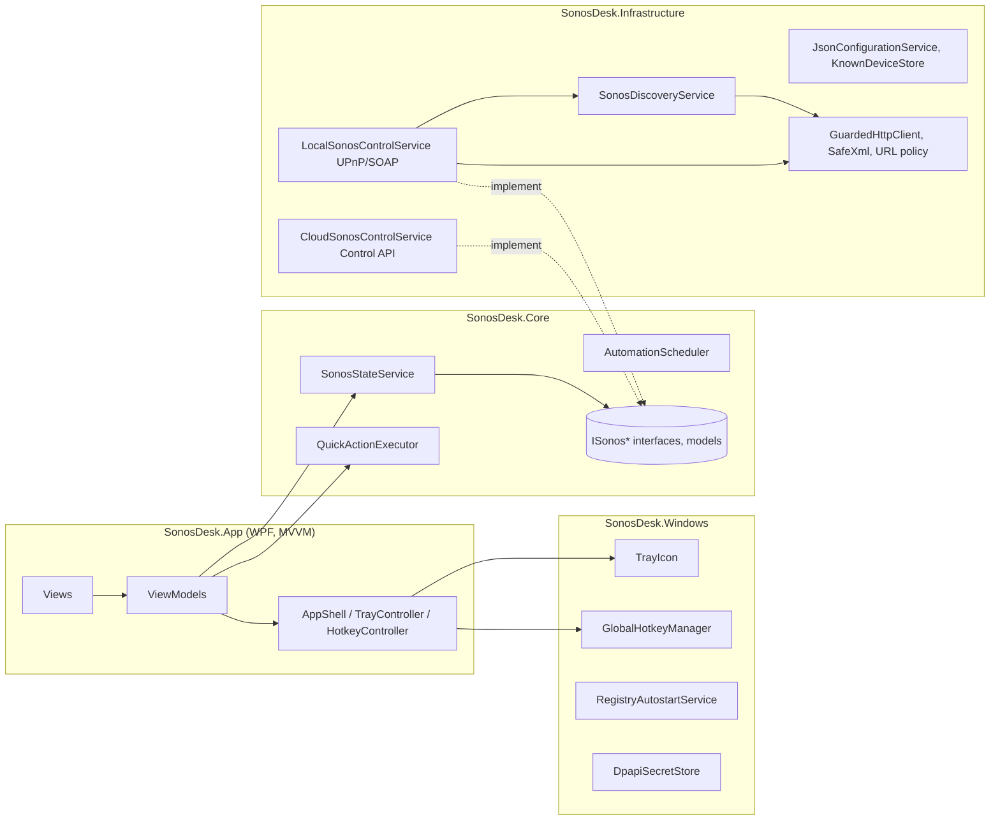

# Architecture

SonosDesk is a WPF application organized in four projects. Business logic is independent of WPF and
fully testable without speakers.

## Key interfaces (`SonosDesk.Core.Interfaces`)

| Interface | Responsibility |
| --- | --- |
| `ISonosDiscoveryService` | Finds devices (SSDP + probes), tracks added/updated/lost/recovered devices |
| `ISonosControlService` | One complete backend; exposes the services below plus `Capabilities` |
| `ISonosTopologyService` | Rooms, players and groups (`SonosTopology`) |
| `ISonosPlaybackService` | Play/pause/next/previous, state, play mode (always per group → coordinator) |
| `ISonosVolumeService` | Player and group volume, mute, relative changes |
| `ISonosGroupService` | Join, leave, create (exact membership), dissolve |
| `ISonosFavoritesService` | "My Sonos" favorites and playing them on a group |
| `ISonosConfigurationService` | Versioned JSON settings |
| `ISecretStore`, `IAutostartService`, `IAppPaths` | Platform services |

`SonosCapabilities` tells the UI what a backend actually supports. Missing features are disabled in the
UI and throw `SonosErrorKind.NotSupported` — they are never simulated.

## Runtime flow

1. `App.OnStartup` acquires the single-instance mutex, loads settings, applies the theme and builds the
   DI container (`AddSonosDesk` + Windows/UI services).
2. `SonosDiscoveryService.StartAsync` loads known devices and starts the background loop and the passive
   SSDP NOTIFY listener.
3. `SonosStateService` polls with adaptive intervals (1 s tick):

   | What | UI visible | Background |
   | --- | --- | --- |
   | Topology (`GetZoneGroupState`) | 30 s, and immediately after device changes | same |
   | Active group (transport, track, volume) | 2 s | 6 s |
   | Other groups | 8 s | 30 s |

   After a command the affected group is refreshed on the next tick.
4. ViewModels subscribe to state events and marshal to the UI thread via `IUiDispatcher`.
5. The tray icon (WinForms `NotifyIcon`) and the WPF flyout share the same `MainViewModel`.
6. "Beenden" in the tray stops the scheduler, state service and discovery (4 s budget), disposes the
   container and shuts down WPF. Closing the window only hides it (configurable).

## Threading

All network I/O is asynchronous. Discovery and polling run on the thread pool. Events from Core and
Infrastructure are raised on background threads; ViewModels never touch UI objects from them directly.
Volume sliders are debounced (180 ms) and ignore polled values for 2.5 s after a local change.

## Persistence

`%LOCALAPPDATA%\SonosDesk\`

| File | Content |
| --- | --- |
| `settings.json` | Versioned settings (`schemaVersion`), atomic writes, corrupt files are backed up |
| `known-devices.json` | Last known device locations (fast start, works without multicast) |
| `secrets\*.bin` | DPAPI-encrypted client secret / OAuth tokens |
| `logos\*.png` | Custom logos of saved radio stations (scaled to 256 px) |
| `logs\sonosdesk-YYYYMMDD.log` | Rolling logs (7 days, max. 5 MB/day) |
